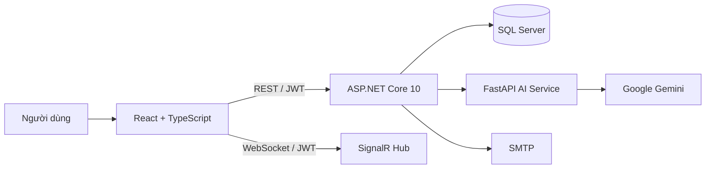

<div align="center">

# ✦ MoneyMind AI

**Hiểu tiền của bạn. Làm chủ tương lai của bạn.**

Ứng dụng quản lý tài chính cá nhân kết hợp dữ liệu thu chi, ngân sách,
mục tiêu tiết kiệm và trợ lý AI thông minh bằng tiếng Việt.

[](https://dotnet.microsoft.com/)
[](https://react.dev/)
[](https://www.python.org/)
[](https://www.microsoft.com/sql-server)
[](#)

[Bắt đầu nhanh](#-bắt-đầu-nhanh) · [Kiến trúc](#-kiến-trúc) · [Cài đặt](./DEVELOPMENT_SETUP.md) · [AI Service](./ai-service/README.md)

</div>

---

## 🌟 MoneyMind AI là gì?

MoneyMind AI biến dữ liệu thu chi thành bức tranh tài chính trực quan và hữu ích.
Người dùng có thể theo dõi tài khoản, đặt ngân sách, quản lý mục tiêu tiết kiệm
và trao đổi với trợ lý AI dựa trên dữ liệu tài chính của chính mình.

| 💰 Quản lý tài chính | 🤖 Trợ lý AI | 🛡️ Quản trị & bảo mật |
|---|---|---|
| Giao dịch, tài khoản, danh mục | Hỏi đáp bằng ngôn ngữ tự nhiên | JWT, refresh token, vai trò |
| Ngân sách và mục tiêu | Lịch sử hội thoại và phản hồi | Phân quyền người dùng/Admin |
| Dashboard và biểu đồ | Gemini fallback và quota | Dữ liệu được tách theo tài khoản |

---

## ✨ Tính năng

### 👤 Không gian cá nhân

- Đăng ký, đăng nhập và đăng nhập bằng Google
- Quản lý tài khoản thanh toán
- Thêm, sửa, xóa và lọc giao dịch
- Quản lý danh mục thu/chi
- Lập và theo dõi ngân sách
- Tạo mục tiêu tiết kiệm và ghi nhận đóng góp
- Xem tổng quan, xu hướng và báo cáo theo kỳ
- Quản lý thông báo, hồ sơ, múi giờ và bảo mật

### 🧠 Trợ lý tài chính

- Hỏi đáp tài chính bằng tiếng Việt
- Theo ngữ cảnh dữ liệu người dùng
- Lưu lịch sử hội thoại
- Đổi tên, lưu trữ và xóa cuộc trò chuyện
- Gửi phản hồi cho câu trả lời AI
- Giới hạn số lượt hỏi theo ngày
- Tự động chuyển sang model Gemini dự phòng khi model chính gặp sự cố

### 🛠️ Khu vực quản trị

- Quản lý người dùng, khóa/mở khóa tài khoản
- Cấu hình hạn mức AI cho từng người dùng
- Quản lý thông báo hệ thống
- Quản lý danh mục và giao dịch
- Xem log AI, health check và nhật ký hoạt động
- Cấu hình tham số hệ thống

---

## 🏗️ Kiến trúc



> **Nguyên tắc bảo mật:** trình duyệt không gọi trực tiếp Gemini hoặc AI service.
> ASP.NET Core chịu trách nhiệm xác thực, phân quyền, kiểm tra quota và điều phối AI.

| Thành phần | Công nghệ | Trách nhiệm chính |
|---|---|---|
| Frontend | React 18, TypeScript 5, Vite 6, Tailwind CSS 4 | Giao diện, định tuyến và trải nghiệm người dùng |
| Backend | ASP.NET Core 10, Entity Framework Core 10 | Xác thực, phân quyền và nghiệp vụ tài chính |
| Database | SQL Server | Lưu tài khoản, giao dịch, ngân sách và AI log |
| AI Service | Python, FastAPI, Google Gen AI SDK | Gọi Gemini và fallback model |
| Realtime | ASP.NET Core SignalR | Nhận thông báo theo thời gian thực |

---

## 📁 Cấu trúc dự án

```text
MoneyMind_AI/
├── frontend/                 # React + TypeScript
├── backend/                  # ASP.NET Core Web API
├── ai-service/               # FastAPI + Google Gemini
├── README.md                 # Tổng quan dự án
└── DEVELOPMENT_SETUP.md      # Hướng dẫn môi trường phát triển
```

---

## 🔧 Yêu cầu môi trường

| Công cụ | Phiên bản khuyến nghị |
|---|---|
| Windows | Windows 10/11 |
| .NET SDK | 10.0 trở lên |
| SQL Server | SQL Server 2019+ hoặc SQL Server Express |
| Node.js | 20 trở lên |
| npm | Đi kèm Node.js |
| Python | 3.11 trở lên |
| Git | Phiên bản mới |

---

## 🚀 Bắt đầu nhanh

Hướng dẫn chi tiết xem tại [DEVELOPMENT_SETUP.md](./DEVELOPMENT_SETUP.md).

### 1. Tạo file cấu hình local

```powershell
Copy-Item backend/.env.example backend/.env
Copy-Item ai-service/.env.example ai-service/.env
Copy-Item frontend/.env.example frontend/.env.local
```

### 2. Khởi động AI service

```powershell
cd ai-service
python -m venv .venv
.\.venv\Scripts\Activate.ps1
python -m pip install -r requirements.txt
python run.py
```

### 3. Khởi động backend

Mở terminal thứ hai:

```powershell
cd backend
dotnet restore
dotnet ef database update
dotnet run --launch-profile http
```

### 4. Khởi động frontend

Mở terminal thứ ba:

```powershell
cd frontend
npm ci --legacy-peer-deps
npm run dev
```

Mở trình duyệt tại **<http://localhost:5173>**.

---

## 🌐 Địa chỉ local

| Thành phần | Địa chỉ |
|---|---|
| Giao diện | <http://localhost:5173> |
| Backend API | <http://localhost:5146> |
| Swagger UI | <http://localhost:5146/swagger> |
| Health check | <http://localhost:5146/api/health> |
| Notification Hub | `ws://localhost:5146/hubs/notifications` |
| Internal AI | <http://127.0.0.1:8001> |

---

## ⚙️ Cấu hình quan trọng

| Tên biến | Thành phần | Mục đích |
|---|---|---|
| `ConnectionStrings__DefaultConnection` | Backend | Kết nối SQL Server |
| `Jwt__Key` | Backend | Ký access token |
| `Encryption__MasterKey` | Backend | Mã hóa khóa dữ liệu |
| `AIService__ServiceKey` | Backend | Xác thực backend với AI service |
| `SERVICE_KEY` | AI Service | Khóa bắt buộc phải giống bên backend |
| `GEMINI_API_KEY` | AI Service | Truy cập Google Gemini |
| `Google__ClientId` | Backend | Xác thực Google ID token |
| `VITE_GOOGLE_CLIENT_ID` | Frontend | Hiển thị nút đăng nhập Google |

<div align="center">

> [!WARNING]
> Không commit `.env`, `.env.local`, API key, JWT key hoặc mật khẩu.
> Không thay đổi `Encryption__MasterKey` sau khi dữ liệu đã được mã hóa.

</div>

Tạo khóa local bằng PowerShell:

```powershell
# 32-byte Base64 key cho Encryption__MasterKey
[Convert]::ToBase64String([Security.Cryptography.RandomNumberGenerator]::GetBytes(32))

# 32-byte hex key cho JWT hoặc AI service
[Convert]::ToHexString([Security.Cryptography.RandomNumberGenerator]::GetBytes(32))
```

---

## 🧪 Kiểm thử

AI service hiện có unit test cho:

- Model fallback
- API quota và cooldown
- Timeout và lỗi provider
- Response không hợp lệ
- Quy tắc chuyển model

```powershell
cd ai-service
python -m unittest discover -s tests -v
```

> Repository chưa cấu hình test project cho backend và frontend.
> Hãy ưu tiên bổ sung integration test trước khi release.

---

## 🔐 Quy tắc bảo mật

- Frontend không chứa Gemini API key
- AI service chỉ dành cho backend truy cập nội bộ
- Mọi dữ liệu tài chính phải được kiểm tra chủ sở hữu
- Admin endpoint phải yêu cầu role `Admin`
- Refresh token và session phải được revoke trên server
- Production sử dụng HTTPS, secret riêng và CORS giới hạn
- Không trả provider response hoặc credential ra ngoài

---

## 🛠️ Lệnh phát triển

<details>
<summary><strong>Backend</strong></summary>

```powershell
cd backend
dotnet restore
dotnet build
dotnet run --launch-profile http
dotnet ef migrations add <MigrationName>
dotnet ef database update
dotnet ef migrations remove
```

</details>

<details>
<summary><strong>Frontend</strong></summary>

```powershell
cd frontend
npm ci --legacy-peer-deps
npm run dev
npm run build
npm run preview
```

</details>

<details>
<summary><strong>AI Service</strong></summary>

```powershell
cd ai-service
.\.venv\Scripts\Activate.ps1
python run.py
python -m unittest discover -s tests -v
```

</details>

---

## 📚 Tài liệu

- [Hướng dẫn cài đặt và phát triển](./DEVELOPMENT_SETUP.md)
- [Tìm và sửa lỗi](./TROUBLESHOOTING.md)
- [Tài liệu AI Service](./ai-service/README.md)

---

<div align="center">

**Hiểu tiền của bạn. Làm chủ tương lai của bạn.**

Made for personal finance management

</div>
