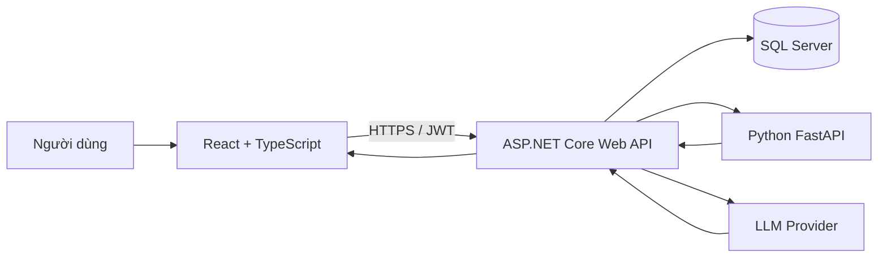

# ✦ MoneyMind AI

### Hiểu tiền của bạn. Làm chủ tương lai của bạn.

Ứng dụng quản lý tài chính cá nhân kết hợp **Conversational AI** và **Proactive AI** —
biến những con số thu chi thành thông tin dễ hiểu, hữu ích và đúng lúc.

 

---

## ✨ MoneyMind AI là gì?

MoneyMind AI là đề tài ứng dụng quản lý tài chính cá nhân dành cho những ai muốn theo dõi thu nhập, chi tiêu, ngân sách và mục tiêu tiết kiệm ở một nơi. Thay vì chỉ hiển thị biểu đồ hay đưa ra câu trả lời chung chung, ứng dụng hướng đến việc giúp bạn **hỏi về dữ liệu tài chính của chính mình** và nhận được những phân tích chủ động, có căn cứ.

> **Một nguyên tắc cốt lõi:** nghiệp vụ và dữ liệu đã xác minh tạo ra con số; AI giúp bạn hiểu con số đó.

## 🌱 Hai cách AI đồng hành

| | Conversational AI | Proactive AI |
|---|---|---|
| **Cách hoạt động** | Bạn hỏi bằng ngôn ngữ tự nhiên; trợ lý truy vấn dữ liệu phù hợp rồi giải thích kết quả. | Hệ thống phân tích theo sự kiện hoặc lịch và chủ động gửi insight, báo cáo, cảnh báo. |
| **Ví dụ** | “Tháng này mình chi nhiều nhất vào khoản nào?” | “Bạn đã sử dụng 80% ngân sách ăn uống.” |
| **Giá trị** | Hiểu tình hình tài chính mà không cần tự lọc nhiều báo cáo. | Nhận ra xu hướng đáng chú ý mà không phải liên tục đặt câu hỏi. |

## 💎 Những trải nghiệm hướng tới

- **Ghi chép thu chi:** thêm, sửa, xóa, tìm kiếm và lọc giao dịch theo thời gian, danh mục hoặc tài khoản.
- **Tổng quan tài chính:** theo dõi thu nhập, chi tiêu, chênh lệch thu chi và biểu đồ theo kỳ.
- **Ngân sách & mục tiêu:** theo dõi mức sử dụng ngân sách và tiến độ tiết kiệm.
- **Trợ lý tiếng Việt:** hỏi về tổng chi, danh mục chi nhiều nhất, ngân sách còn lại hoặc so sánh giữa các tháng.
- **Gợi ý phân loại:** đề xuất danh mục kèm độ tin cậy; bạn vẫn là người quyết định.
- **Phân tích thông minh:** nhận diện xu hướng, khoản chi khác thường và dự báo khi dữ liệu đủ cơ sở.
- **Insight chủ động:** cảnh báo ngân sách, báo cáo định kỳ và nhắc xem lại mục tiêu.

## 🧠 Hybrid AI — thông minh nhưng có kiểm soát

MoneyMind AI phân chia trách nhiệm để câu trả lời hữu ích mà không đánh đổi độ tin cậy:

1. **Backend và cơ sở dữ liệu** xử lý quyền truy cập, dữ liệu giao dịch và các phép tính tài chính.
2. **Dịch vụ phân tích** hỗ trợ phân loại, nhận diện bất thường và dự báo khi phù hợp.
3. **LLM** hiểu câu hỏi, diễn đạt và giải thích kết quả đã được hệ thống cung cấp.
4. **Người dùng** kiểm tra, xác nhận và luôn kiểm soát thay đổi trên dữ liệu của mình.

AI không tự tạo số liệu tài chính, không tự thực hiện giao dịch và không thay đổi dữ liệu nghiệp vụ nếu chưa được xác nhận. Cảnh báo bất thường là tín hiệu thống kê — **không phải kết luận gian lận**; dự báo là ước tính — **không phải cam kết chắc chắn**.

## 🏗️ Kiến trúc dự kiến

| Thành phần | Công nghệ dự kiến | Trách nhiệm |
|---|---|---|
| Giao diện | React, TypeScript, Bootstrap hoặc Tailwind CSS | Dashboard, biểu đồ và giao diện hội thoại |
| Backend | ASP.NET Core 10 Web API | Xác thực, nghiệp vụ tài chính, phân quyền và điều phối AI |
| Cơ sở dữ liệu | SQL Server | Lưu người dùng, tài khoản, giao dịch và dữ liệu ứng dụng |
| Dịch vụ AI | Python, FastAPI | Phân tích dữ liệu và cung cấp các chức năng AI |
| Phân tích dữ liệu | scikit-learn, pandas, NumPy | Phân loại, phát hiện bất thường và dự báo |
| Ngôn ngữ tự nhiên | LLM API hoặc mô hình triển khai riêng | Hiểu câu hỏi, tóm tắt và giải thích kết quả |

> Đây là **kiến trúc và công nghệ đề xuất trong thuyết minh đề tài**, không phải xác nhận rằng toàn bộ thành phần đã được triển khai.

## 🛣️ Lộ trình MVP

1. **Nền tảng:** xác thực, tài khoản, danh mục và quản lý giao dịch.
2. **Thống kê:** dashboard thu chi, ngân sách và mục tiêu tiết kiệm.
3. **Conversational AI:** hỏi đáp theo dữ liệu người dùng.
4. **Proactive AI:** insight, cảnh báo ngân sách và phân tích xu hướng.
5. **Hoàn thiện:** kiểm thử phân quyền, độ chính xác, hiệu năng và trải nghiệm.

### Phạm vi MVP

Giao dịch được **người dùng nhập thủ công** để ưu tiên kiểm soát dữ liệu và tập trung vào nghiệp vụ tài chính cùng chất lượng phân tích.

**Chưa thuộc phạm vi MVP:** đồng bộ tự động với ngân hàng, thanh toán/chuyển tiền thay người dùng, khuyến nghị đầu tư hoặc tự ý sửa/xóa dữ liệu.

## 🔐 Quyền riêng tư & độ tin cậy

- Chỉ truy vấn dữ liệu thuộc về người dùng đã xác thực.
- Ưu tiên gửi cho AI lượng dữ liệu tối thiểu cần thiết; số liệu được tính từ dữ liệu nghiệp vụ.
- Không để trình duyệt gọi trực tiếp dịch vụ AI hoặc nhà cung cấp LLM.
- Phân biệt rõ số liệu thực tế, ước tính và gợi ý; nêu giới hạn khi dữ liệu chưa đủ.
- Mọi thay đổi ảnh hưởng đến dữ liệu cần có sự kiểm soát của người dùng.

## 🚧 Trạng thái dự án

README này được biên soạn từ **thuyết minh đề tài MoneyMind AI**. Tài liệu mô tả ý tưởng, tính năng mục tiêu, kiến trúc và kế hoạch MVP; repository hiện chưa cung cấp đủ mã nguồn hoặc hướng dẫn chạy ứng dụng để công bố lệnh cài đặt chính xác.

## 🎯 Tầm nhìn

MoneyMind AI hướng đến một người bạn đồng hành tài chính giúp bạn không chỉ biết **đã chi bao nhiêu**, mà còn hiểu **tiền đang đi đâu** — và có thêm cơ sở để quyết định bước tiếp theo.

**Your money, understood.**

