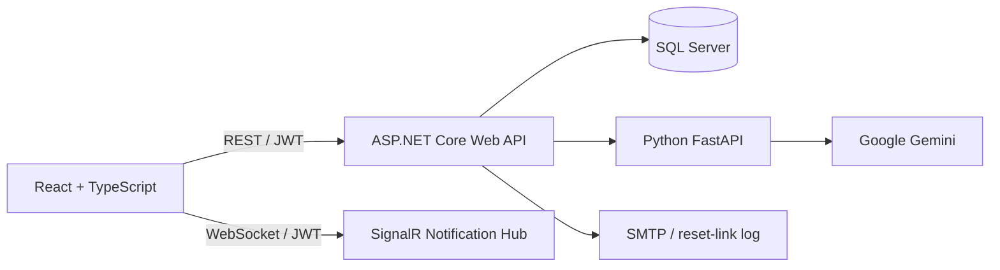

# MoneyMind AI

MoneyMind AI is a personal-finance web application that combines transaction management,
budgets, savings goals, financial reports and conversational AI.

The project uses a three-tier architecture:

- React + TypeScript frontend
- ASP.NET Core 10 Web API
- Python FastAPI service for Gemini integration
- SQL Server database

## Features

### Personal finance

- Account registration and login
- Google sign-in
- Transaction management
- Account, category and budget management
- Savings goals and contributions
- Monthly summaries, trends and reports
- Financial notifications and reminders
- Profile, time-zone and security settings

### AI

- Vietnamese conversational financial assistant
- Chat history and conversation management
- Financial context restricted to the authenticated user's data
- AI feedback and usage quota
- Gemini model fallback and cooldown handling
- Proactive budget, savings and transaction notifications

### Administration

- User, lock and unlock management
- Per-user AI quota management
- Announcement management
- Category and transaction management
- System settings and audit logs
- AI processing logs and health checks

## Architecture



The frontend must not call the Gemini provider or internal AI service directly. The ASP.NET
Core backend authenticates requests, authorizes the user's data, applies AI quotas and calls
the internal Python service.

| Component | Technology | Main responsibility |
|---|---|---|
| Frontend | React 18, TypeScript 5, Vite 6, Tailwind CSS 4 | User interface and client session handling |
| Backend | ASP.NET Core 10, Entity Framework Core 10 | Authentication, authorization and financial/business logic |
| Database | SQL Server | Persistent application data |
| AI service | Python, FastAPI, Google Gen AI SDK | Structured Gemini calls and model fallback |
| Real-time | ASP.NET Core SignalR | Notifications |

## Repository layout

```text
MoneyMind_AI/
├── frontend/          React application
├── backend/           ASP.NET Core Web API
├── ai-service/        Internal FastAPI and Gemini integration
├── README.md
└── DEVELOPMENT_SETUP.md
```

## Requirements

- Windows 10/11 or a compatible development environment
- .NET SDK 10
- SQL Server 2019+ or SQL Server Express
- Node.js 20+ and pnpm
- Python 3.11+
- Git

Python 3.11 or later is recommended for the current FastAPI and Pydantic dependencies.

## Quick start

The complete setup is documented in [DEVELOPMENT_SETUP.md](./DEVELOPMENT_SETUP.md).

### 1. Configure environment files

Create local configuration from the provided examples:

```powershell
Copy-Item backend/.env.example backend/.env
Copy-Item ai-service/.env.example ai-service/.env
Copy-Item frontend/.env.example frontend/.env.local
```

At minimum, set a SQL Server connection string, JWT key, encryption master key, AI service key
and Gemini API key in the appropriate files. Never commit real secrets.

### 2. Start SQL Server

Use SQL Server or SQL Server Express and make sure the server instance used by the connection
string is running.

### 3. Start the AI service

```powershell
cd ai-service
python -m venv .venv
.\.venv\Scripts\Activate.ps1
python -m pip install -r requirements.txt
python run.py
```

The AI service listens on `http://127.0.0.1:8001` by default.

### 4. Start the backend

Open a second terminal:

```powershell
cd backend
dotnet restore
dotnet tool install --global dotnet-ef --version 10.0.0
dotnet ef database update
dotnet run --launch-profile http
```

The backend listens on `http://localhost:5146`.

The database migration creates the schema and the seeder creates roles, default categories,
default AI quota settings and an optional configured administrator.

### 5. Start the frontend

Open a third terminal:

```powershell
cd frontend
corepack enable
pnpm install --frozen-lockfile
pnpm dev
```

Open `http://localhost:5173`.

The Vite development server proxies `/api` requests to
`http://localhost:5146`, so a separate CORS origin is not required for the default setup.

## Configuration

Configuration examples are provided for each runtime:

| File | Purpose |
|---|---|
| `backend/.env.example` | SQL Server, JWT, encryption, seed admin, SMTP and AI settings |
| `ai-service/.env.example` | Gemini credentials, model priority and service listener |
| `frontend/.env.example` | Optional API and Google sign-in overrides |

Important shared values:

- `Jwt__Key` and `Encryption__MasterKey` must be set in `backend/.env`.
- `AIService__ServiceKey` in `backend/.env` must equal `SERVICE_KEY` in `ai-service/.env`.
- `Google__ClientId` and `VITE_GOOGLE_CLIENT_ID` must use the same Web OAuth client ID.
- The encryption master key must not be changed after application data is encrypted.

Generate local secrets with PowerShell:

```powershell
[Convert]::ToBase64String([Security.Cryptography.RandomNumberGenerator]::GetBytes(32))
[Convert]::ToHexString([Security.Cryptography.RandomNumberGenerator]::GetBytes(32))
```

The first command is suitable for `Encryption__MasterKey`. Use at least 32 random characters
for `Jwt__Key` and both AI service keys.

## Local endpoints

| Service | URL |
|---|---|
| Frontend | `http://localhost:5173` |
| Backend API | `http://localhost:5146` |
| Swagger/OpenAPI UI | `http://localhost:5146/swagger` |
| Backend health check | `http://localhost:5146/api/health` |
| Notification hub | `ws://localhost:5146/hubs/notifications` |
| Internal AI health | `http://127.0.0.1:8001/health` |

The AI service health and chat endpoints require `X-Service-Key`.

Example backend health check:

```powershell
Invoke-RestMethod -Uri "http://localhost:5146/api/health"
```

Example AI health check:

```powershell
$headers = @{ "X-Service-Key" = "<same AI service key>" }
Invoke-RestMethod -Uri "http://127.0.0.1:8001/health" -Headers $headers
```

## Development commands

### Backend

```powershell
cd backend
dotnet restore
dotnet build
dotnet run --launch-profile http
dotnet ef migrations add <MigrationName>
dotnet ef database update
dotnet ef migrations remove
```

### Frontend

```powershell
cd frontend
pnpm install --frozen-lockfile
pnpm dev
pnpm build
pnpm preview
```

### AI service

```powershell
cd ai-service
.\.venv\Scripts\Activate.ps1
python run.py
python -m unittest discover -s tests -v
```

## Testing

The AI service currently includes unit tests for Gemini model fallback and error classification.
Run them before changing the model router or provider integration:

```powershell
cd ai-service
python -m unittest discover -s tests -v
```

Backend and frontend test infrastructure is not yet included. Before release, add coverage for:

- Authentication and authorization
- Session refresh and logout
- Transactions, budgets and savings goals
- User and data isolation
- Dashboard and report calculations
- AI quota and model fallback
- Admin role restrictions
- Critical frontend workflows

## Security

- Keep `.env`, `.env.local`, private keys and credentials out of Git.
- Use separate development and production secrets.
- The frontend never receives Gemini or SMTP credentials.
- AI requests are limited to data belonging to the authenticated user.
- Every admin endpoint must be checked with `Admin` role authorization.
- Never change `Encryption__MasterKey` after encrypted chat or key data has been stored.
- Use HTTPS and restricted CORS origins in production.
- Do not expose provider responses or API credentials through the AI service.

## Troubleshooting

### Backend cannot start

Check that:

- `.NET 10 SDK` is installed.
- `backend/.env` exists and contains `ConnectionStrings__DefaultConnection`.
- `Jwt__Key`, `AIService__ServiceKey` and `Encryption__MasterKey` satisfy validation.
- SQL Server is running and the instance name is correct.
- Entity Framework migrations have been applied.

### Frontend cannot reach the API

Confirm that:

- Backend is listening on `http://localhost:5146`.
- `frontend/.env.local` has no incompatible `VITE_API_URL` value.
- Vite was restarted after changing environment variables.

### Database migration fails

Verify the connection string, SQL Server permissions and running database engine. If SQL Server
Express is used, a value such as `localhost\SQLEXPRESS` may be required.

### AI service cannot answer

Verify that:

- Gemini and service keys are configured.
- `AIService__ServiceKey` matches `SERVICE_KEY`.
- The selected Gemini models are available to the configured API key.
- The backend can reach `http://127.0.0.1:8001`.
- `python run.py` is running in the AI service terminal.

## Further documentation

- [Development setup](./DEVELOPMENT_SETUP.md)
- [AI service documentation](./ai-service/README.md)
